Lab 3: Containers

Module: DevOps

Academic Year: 2026–2027

Instructor: Dr. Ahlem Belabbaci

Team: Yasser Chiheb, Abdel Moumene Senoune

Repo: https://github.com/yasser6102003/ctf-scoreboard

Exercise 1 answers:

a) scoreboard:local is 266 MB and python:3.12-slim is 180 MB.

b) The source code and the build files (src/, pyproject.toml, README.md, requirements.txt), and the pip install steps with everything they downloaded. The runtime image only gets /opt/venv and data/.

c) Without the source code, an attacker inside the container has less to read and to change, and no build file (or secret added by mistake) is shipped. Without the pip install steps, nothing left over from the build is in the image, so it is smaller and has fewer things that can have a vulnerability.

d) Docker uses cache to avoid repeating unchanged steps. Since `requirements.txt` rarely changes, Docker reuses the installed packages when only the source code changes. In our second build, only the last two steps ran again, reducing the build time from 112 seconds to 8.4 seconds. This is why we copy `requirements.txt` before `src/`.

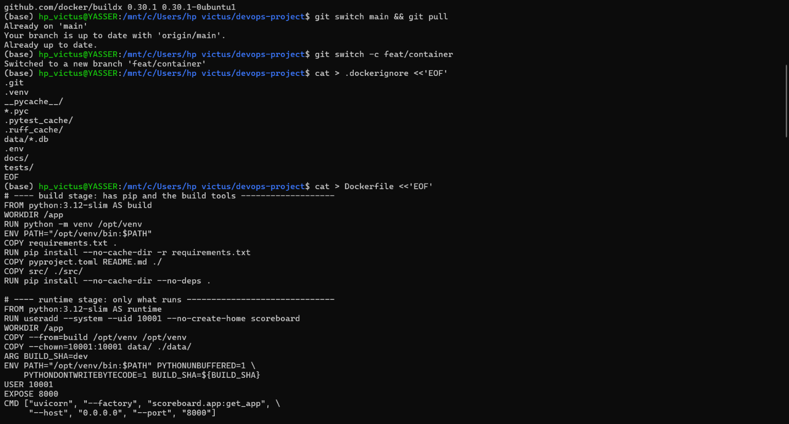

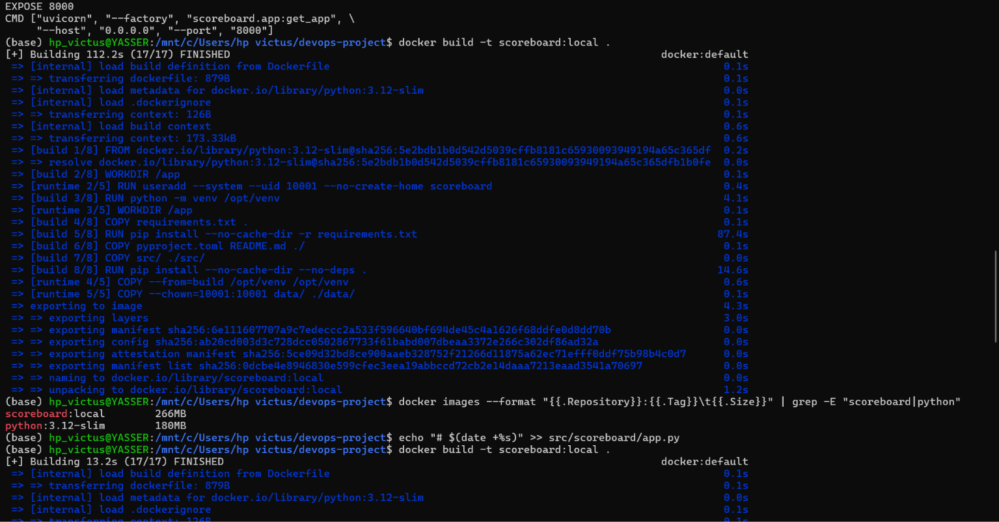

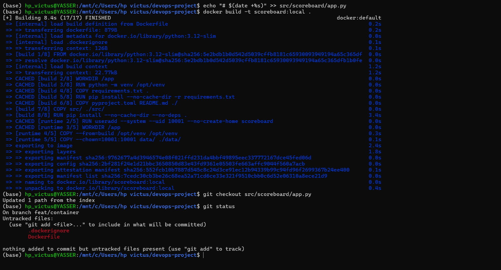

Exercise 2 answers:

a) The named volume -v sbdata:/app/data. The database is written in /app/data, so this folder stays writable even if the rest is read-only.

b) Docker creates the named volume and gives it the same owner as /app/data in the image (UID 10001), so the app can write in it. A host folder like $PWD/data belongs to our user, so UID 10001 cannot write in it and the app cannot open the database.

c) --read-only: the attacker cannot change the app files or install a tool in the container. --cap-drop ALL: the attacker has no special Linux rights, for example he cannot change file owners or use a port under 1024.

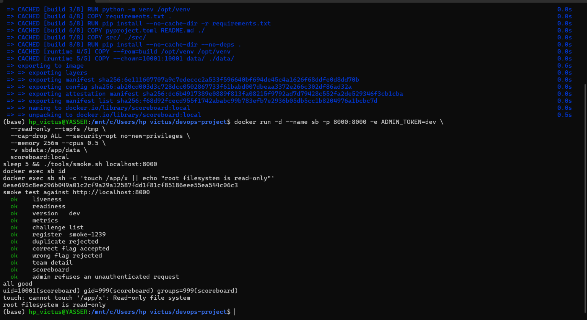

Exercise 3 answers:

a) docker stop sb took 0.879 s and docker stop sb2 took 10.299 s.

b) docker stop sends SIGTERM to PID 1. In sb, PID 1 is uvicorn, so it gets SIGTERM and stops at once. In sb2, PID 1 is a shell (sh -c ...), and the shell does not send SIGTERM to Python. So Docker waits 10 seconds and then kills it with SIGKILL.

c) Each replica takes 10 seconds more to stop, so 20 replicas take about 200 seconds (more than 3 minutes) more. Also each one is killed with SIGKILL, so the requests it was answering are lost.

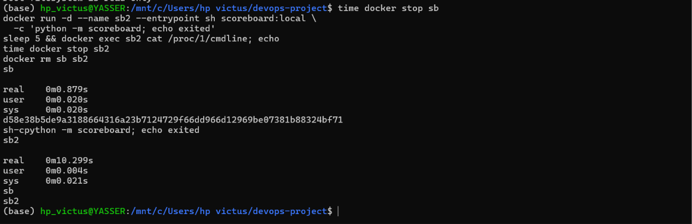

Exercise 4 answers:

a) 2 findings, both HIGH, in one Debian package: zlib1g (CVE-2026-76844 and CVE-2026-85091). The Python packages have 0 findings.

b) pip-audit only checks the Python packages in requirements.txt. Trivy checks the whole image, also the Debian packages that come with python:3.12-slim. The problem is in the base image, not in our Python packages, so pip-audit could not see it.

c) With a fixed version we always get the same results for the same image. And a moving version like latest could one day be changed or hacked and run on our image.

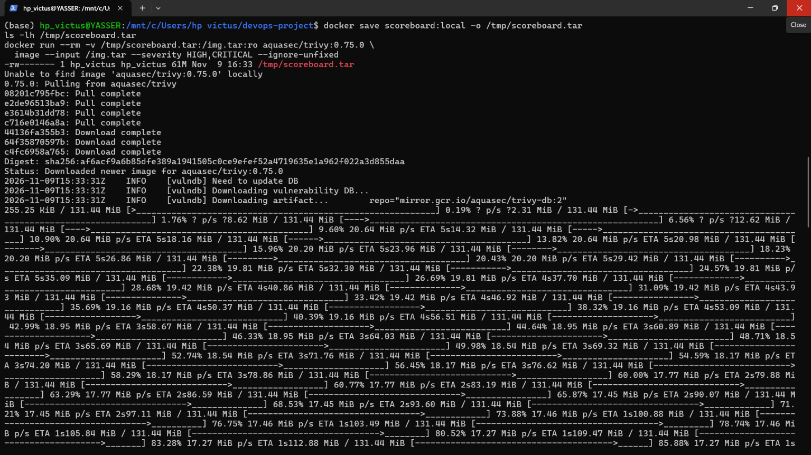

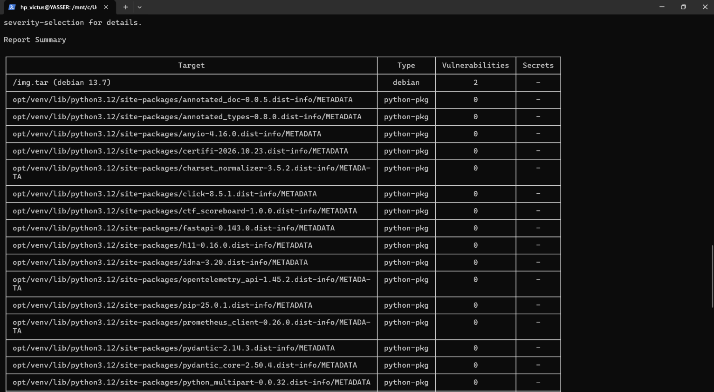

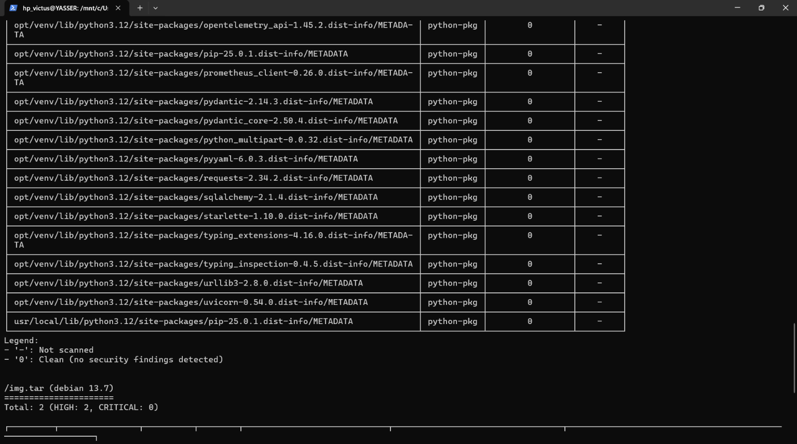

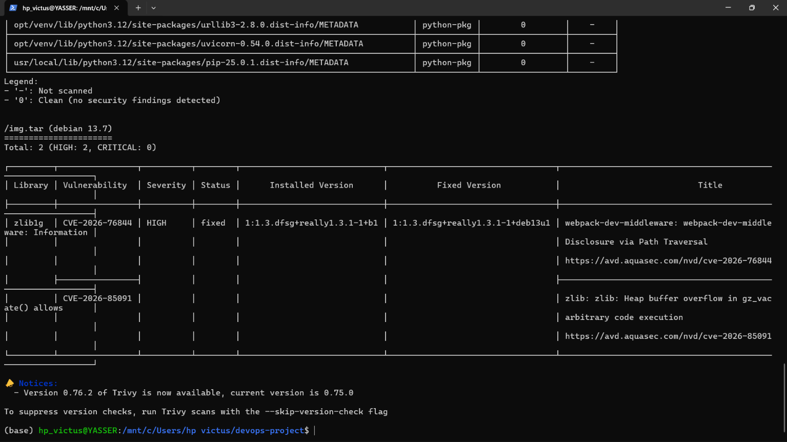

Exercise 5 answers:

a) Git commit -> github.sha in GitHub Actions -> build-arg BUILD_SHA and image tag -> ENV BUILD_SHA in the image -> image pushed to ghcr.io -> docker run -> the app reads BUILD_SHA -> /version shows the commit (72ff0a6e03dc6f51422b1ee499eac5c92eb55a5d).

b) latest always points to the last image pushed. If both versions are called latest, a server can run the new one when we wanted the old one, and we cannot tell which version answered.

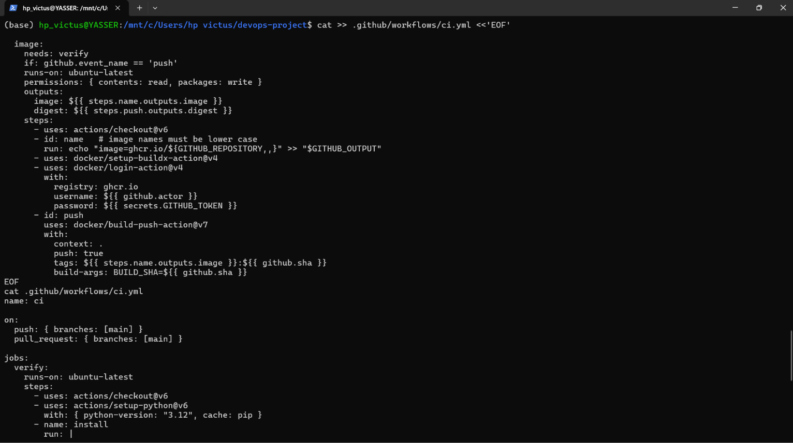

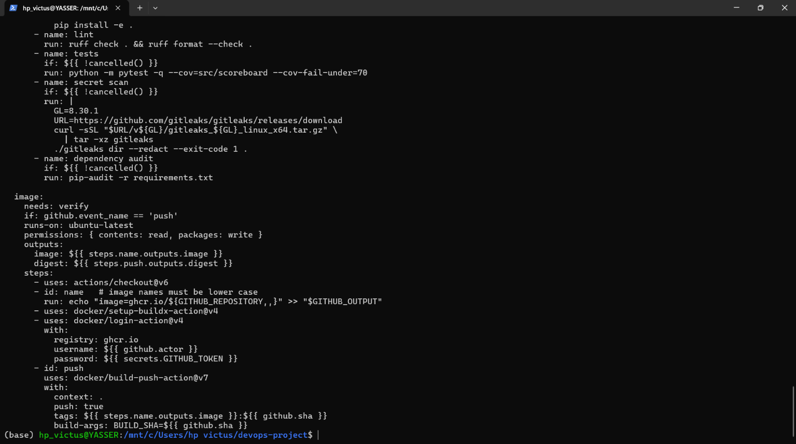

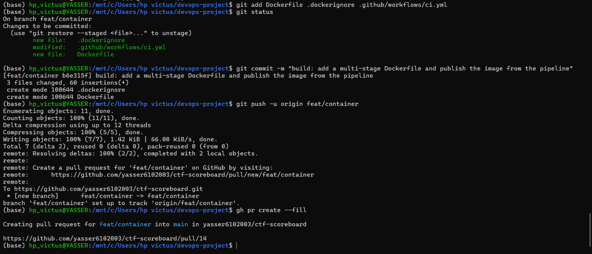

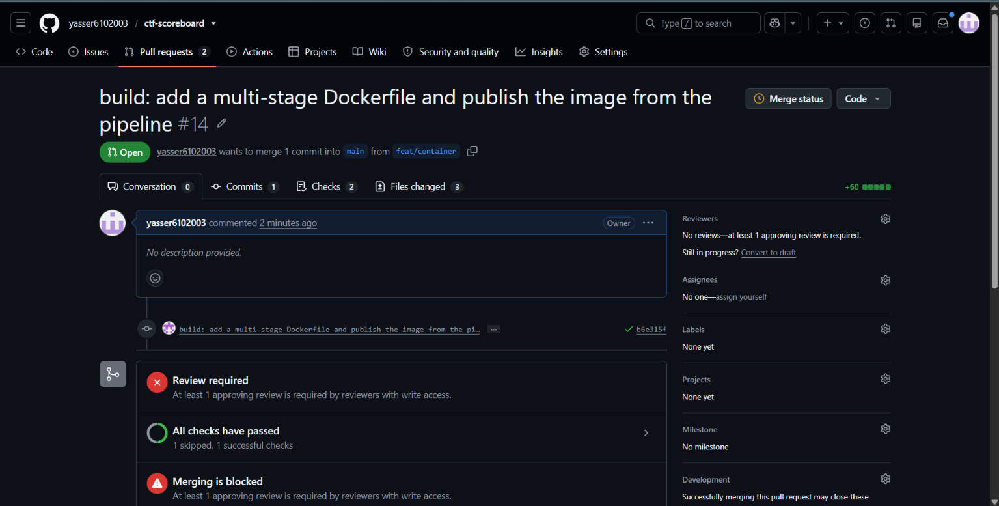

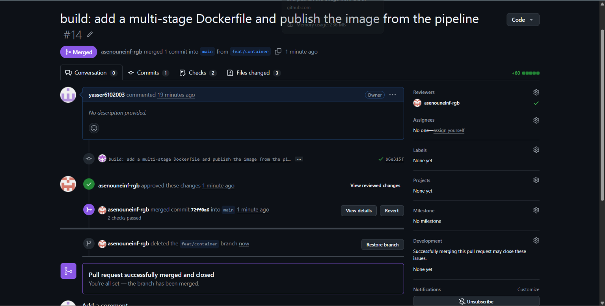

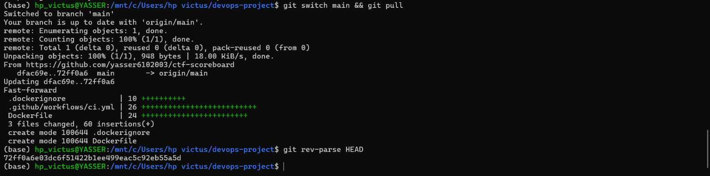

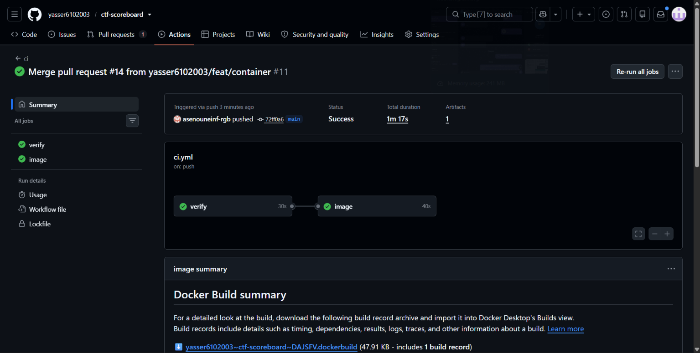

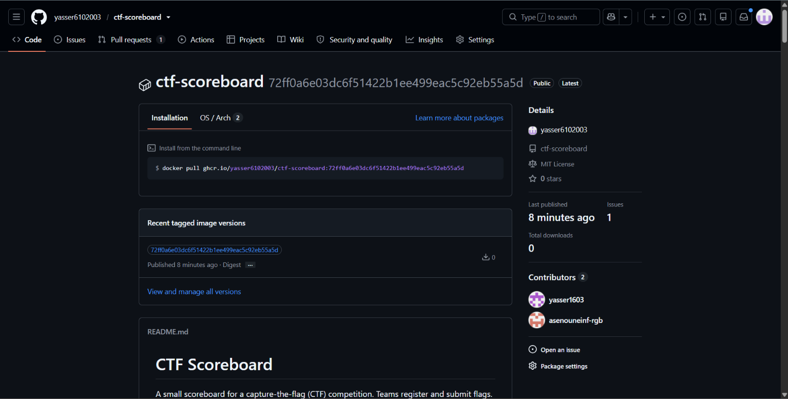

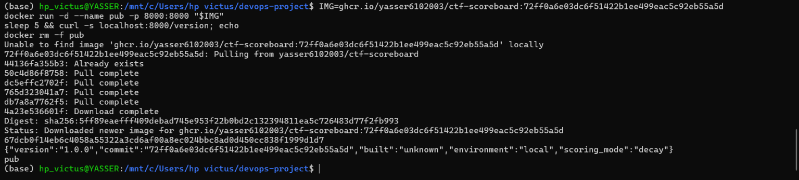

Screenshots:

All the commands we ran on our computer are in docs/screenshots/tp3/ (command and output):

01-partA-dockerignore-dockerfile.png: creating .dockerignore and Dockerfile on the branch feat/container.

02-partA-build-and-sizes.png: the first docker build (112 s) and the sizes (266 MB and 180 MB).

03-partA-cache-test.png: Exercise 1d, one byte changed in app.py, then the build with steps 2 to 6 CACHED and only COPY src/ and pip install run again (8.4 s), then git checkout and git status. Our first try of this test failed at the end with a Docker storage error (parent snapshot does not exist); building again fixed it.

04-partB-run-smoke-id-readonly.png: docker run with all the restrictions, smoke test "all good", id (uid=10001) and the read-only root filesystem.

05-partC-sigterm-stop-times.png: the two stop times (0.879 s and 10.299 s) and PID 1 of sb2.

06-partD-trivy-download.png, 07-partD-trivy-summary-1.png, 08-partD-trivy-summary-2.png and 09-partD-trivy-findings.png: docker save and the Trivy 0.75.0 scan (2 HIGH in zlib1g, 0 in the Python packages).

10-partE-ci-yml-1.png and 11-partE-ci-yml-2.png: the image job added to .github/workflows/ci.yml.

12-partE-commit-push-pr.png: the commit, the push and pull request #14.

13-partE-pr14-checks.png: on the pull request, verify passed and image was skipped.

14-partE-pr14-merged.png: pull request #14 approved and merged.

15-partE-pull-rev-parse.png: git pull on main and the full hash of the merge commit.

16-partE-run-on-main.png: the run on main, verify then image, both green.

17-partE-package-public.png: the package on ghcr.io, now public.

18-partE-version.png: the published image run from ghcr.io, /version shows the same commit hash.
